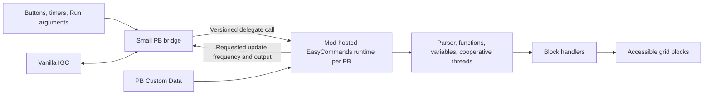

# EasyCommands as a Space Engineers mod

Investigation date: 2026-10-19. Repository snapshot: `b30d548`.

Follow-up: a live runtime proof of concept and measured PB loading comparison are documented in [mod-poc-results.md](mod-poc-results.md). The findings below describe the initial investigation; the follow-up distinguishes verified Mod-target compilation/execution from ordinary package loading, which remains pending.

**Recommendation: move the complete EasyCommands interpreter into a source mod, and keep a small programmable-block bridge for the first release.** This should remove the engine from the PB's 100,000-character source limit and eliminate repeatedly compiling that engine for each PB. Initially, let the PB continue driving ticks; the interpreter, command objects, variables, and block handlers live in the mod. A mod-owned scheduler and a scriptless block are possible later, but are not necessary to address the two stated problems.

The API supports the required building blocks. A local compile-only probe passed against the installed game assemblies. The complete port, the bridge under the game's whitelist, and performance improvements still require an in-game prototype; this investigation does not claim those have been tested.

## What the current implementation tells us

The existing packed artifact contains **96,043 characters**, leaving **3,957** below the PB limit. This is a measurement of the existing artifact, not a fresh Release build. Its SHA-256 is `1904883B9550C6BD4EA693D236514AD1C401BEBAF3CCC4539D2CB369403823AC`.

| Area | Current responsibility | Implication for migration |
| --- | --- | --- |
| [Program.cs](../EasyCommands/Program.cs), especially lines 34, 115, 128, 157 | Host initialization, static active-program pointer, request/message handling, cooperative threads, update frequency | Extract the engine from `MyGridProgram`; give each PB its own runtime instance |
| [ParsingEngine.cs](../EasyCommands/CommandParsers/ParsingEngine.cs) | Reads Custom Data, detects changes, resets state, incrementally constructs commands/functions | Keep the language and incremental parser; replace the source/host dependency |
| [ProcessingEngine.cs](../EasyCommands/CommandParsers/ProcessingEngine.cs) and other parser files | Token/parameter rules and construction of executable objects | Move together with commands and variables, rather than inventing an AST transport protocol |
| [Commands.cs](../EasyCommands/Commands/Commands.cs), especially lines 224, 244, 263, 402 | Waits, broadcast IGC, control flow, mutable execution state | Abstract elapsed time and transport; add execution budgets |
| [BlockHandlerRegistry.cs](../EasyCommands/BlockHandlers/BlockHandlerRegistry.cs), especially lines 118 and 127 | Looks up blocks/groups through the host's terminal system | Preserve PB access scope and invalidate caches appropriately |
| [ProgrammableBlockHandlers.cs](../EasyCommands/BlockHandlers/ProgrammableBlockHandlers.cs) | Invokes other PBs using `TryRun` | Requires a separate mod invocation implementation |
| [ProgramFactory.cs](../EasyCommands.Tests/ProgramFactory.cs) and [ScriptTest.cs](../EasyCommands.Tests/ScriptTests/ScriptTest.cs) | Supplies mocked PB context and runs language scenarios | Strong starting point for engine/host parity tests; reflection-based factory setup is test infrastructure, not a mod hosting strategy |

Excluding generated output, parser files contain about 108,000 source characters and block handlers about 128,000. These are unminified counts, **not** estimates of their packed contributions. They show why moving only tokenization would leave substantial implementation and compile work in the PB.

The parser produces commands, variables, selectors, and closures that refer to runtime state. There is no existing serialized bytecode boundary. Sending parsed commands back into a PB would create a new format and retain a sizable evaluator and block-handler implementation. Moving the interpreter together is the simpler boundary.

There are also two distinct kinds of startup work:

1. **C# compilation:** the game compiles the EasyCommands implementation when installed/recompiled in a PB.
2. **EasyCommands parsing:** after startup or Custom Data changes, EasyCommands builds its executable command graph. `commandParseAmount = 1` and `commandParameterParseAmount = 100` deliberately spread this work across calls.

A mod addresses the first structurally. It also creates room to optimize the second, but moving the current parser unchanged would retain its incremental parsing delay. Initialization of parser/operator/item tables and construction of each runtime also still cost time.

## What the Mod API provides

**Source distribution and compilation.** Place the engine and mod host under one `Data/Scripts/EasyCommands/` directory. Space Engineers compiles mod source at world load into a shared assembly; creating another block does not require recompiling that engine. The ordinary source-mod workflow does not distribute an arbitrary precompiled application DLL. Compilation/whitelist checks still occur at mod load, and clients may incur mod-loading costs as well as the server. See the [mod scripting guide](https://github.com/THDigi/SE-ModScript-Examples/wiki/Quick-Intro-to-Space-Engineers-Modding#scriptsprogramming-cs-files).

**A PB-to-mod bridge.** [`IMyTerminalControls.CreateProperty<TValue,TBlock>`](https://keensoftwarehouse.github.io/SpaceEngineersModAPI/api/Sandbox.ModAPI.IMyTerminalControls.html) explicitly creates a hidden terminal property usable by PB scripts. Its [value-control getter](https://keensoftwarehouse.github.io/SpaceEngineersModAPI/api/Sandbox.ModAPI.Interfaces.Terminal.IMyTerminalValueControl-1.html) receives the block. Expose a versioned delegate through that property, and retrieve it from the shim using `Me.GetProperty(...).As<T>().GetValue(Me)`. This is an in-process call, not network traffic and not a Custom Data mailbox.

**Optional native scheduling.** A [`MySessionComponentBase`](https://keensoftwarehouse.github.io/SpaceEngineersModAPI/api/VRage.Game.Components.MySessionComponentBase.html) provides session lifecycle and simulation callbacks. A [`MyGameLogicComponent`](https://keensoftwarehouse.github.io/SpaceEngineersModAPI/api/VRage.Game.Components.MyGameLogicComponent.html) can attach behavior to a block. Either can support a later scheduler; they are not prerequisites for letting a PB call the engine.

**Block control.** The mod terminal interfaces include their ingame counterparts, so much of the existing handler code can retain its ingame interface types. [`GetTerminalSystemForGrid`](https://keensoftwarehouse.github.io/SpaceEngineersModAPI/api/Sandbox.ModAPI.IMyTerminalActionsHelper.html) supplies a terminal system for a mod host. This does not by itself reproduce the PB's ownership filtering. Use explicit namespace aliases where mod and ingame interfaces have identical names.

**PB invocation.** The mod [`IMyProgrammableBlock`](https://keensoftwarehouse.github.io/SpaceEngineersModAPI/api/Sandbox.ModAPI.IMyProgrammableBlock.html) exposes `Run`, `ProgramData`, and `Recompile`. Its documentation explicitly says mods should not use `TryRun`. Assigning `ProgramData` recompiles the PB; injecting the complete EasyCommands source through that property would retain the problem we want to solve.

**IGC is a separate concern from multiplayer networking.** [`IMyIntergridCommunicationSystem`](https://keensoftwarehouse.github.io/SpaceEngineersModAPI/api/Sandbox.ModAPI.Ingame.IMyIntergridCommunicationSystem.html) is PB-addressed and includes reachability, listeners, and broadcast/unicast operations. [`MyAPIGateway`](https://keensoftwarehouse.github.io/SpaceEngineersModAPI/api/Sandbox.ModAPI.MyAPIGateway.html) does not expose a corresponding public IGC entry point. [`IMyGridProgram.IGC_ContextGetter`](https://keensoftwarehouse.github.io/SpaceEngineersModAPI/api/Sandbox.ModAPI.IMyGridProgram.html) is a context-provider setter; it is not a supported way to retrieve another PB's live script instance. Keep the real PB IGC endpoint for compatibility.

[`IMyMultiplayer`](https://keensoftwarehouse.github.io/SpaceEngineersModAPI/api/VRage.Game.ModAPI.IMyMultiplayer.html) is for client/server messages. Substituting it for IGC would require implementing antenna/reachability and compatibility semantics ourselves. It is appropriate for future UI requests and status synchronization, with server-side validation.

## Recommended first architecture



The distinction is between **where the implementation resides** and **what drives a tick**. A tiny PB can call the mod once per update while all substantial parsing and execution resides in the mod assembly. We do not have to move scheduling simultaneously to achieve the requested benefits.

Proposed call flow:

1. On its first `Main` call, the shim discovers `EasyCommands.Api.v1`, checks compatibility, and registers the PB. Delay registration until `Main`, rather than assuming all dependencies are ready in the constructor.
2. The mod creates or retrieves an engine instance keyed by PB `EntityId`, with a registration generation so recompilation can reset/rebind it deliberately.
3. Each PB invocation passes the argument, update source, elapsed time, and current host services. The engine reads that PB's Custom Data and advances parsing/execution.
4. IGC operations occur synchronously during this invocation using the actual PB IGC context. Output and requested `UpdateFrequency` return to the shim, which applies them using `Echo` and `Runtime`.
5. PB removal, bridge replacement, recompilation, ownership changes, and session unload release or reinitialize state according to an explicit policy.

A possible experimental delegate shape is:

```csharp
Func<string, UpdateType, IMyGridTerminalSystem,
     IMyIntergridCommunicationSystem, double,
     MyTuple<UpdateFrequency, string>>
```

Use only shared framework/game types at this boundary. Identically named custom classes compiled separately in the mod and PB are different CLR types. The signature above compiled in the local probe; it is an experiment, not a frozen public API or a completed whitelist check. A production bridge needs registration/versioning, bounded output, exception containment, and access validation in addition to a tick call.

The terminal property should bind its endpoint to the block supplied to its getter. Registration is useful identification; a block-name convention alone is fragile. Neither a marker nor a caller-supplied entity ID is authorization. Treat host objects supplied by a PB as untrusted, and validate selected blocks and allowed operations in the mod. The PB's terminal system is valuable for compatibility, but does not substitute for enforcing access on privileged mod operations.

Do not retain the PB's runtime, terminal wrapper, or callbacks for asynchronous/background use. The game prepares ownership context around a PB invocation and clears the script's terminal-system property afterward. For this first design, use those services only for the synchronous call.

Keep the full interpreter out of the bridge. A bridge size target of a few thousand characters is reasonable, but has not been measured for a complete implementation. If the mod is absent or incompatible, display a clear error and back off retries; preserve Custom Data. Do not repeatedly rewrite `ProgramData` or silently start a second interpreter.

## Changes that need deliberate engineering

**Isolate each runtime.** Today `Program.PROGRAM` is a static active-instance pointer. Separate compiled PB scripts have separate static state; all instances in one mod assembly would share it. A nested call from PB A into PB B could overwrite A's context and then set it to null on return, even on one OS thread. Prefer explicit execution context passed to commands/selectors/handlers. A scoped save/restore pointer is a possible migration aid, but requires exception-safe restoration, reentrancy tests, and no background execution. Audit other static registries for runtime-specific captures or mutation.

**Bound execution.** EasyCommands' “threads” are cooperative command queues, not OS threads. Retain that model. `MultiActionCommand.Execute` can drain many commands in a single call; expressions, selectors, transfers, and recursive calls also need bounded work. Mod-compiled code must not rely on PB instruction accounting to stop it. Add per-runtime command/operation budgets, recursion and allocation limits, resumable expensive operations, and aggregate server budgets. A stopwatch checked after an unbounded operation cannot prevent that operation from stalling the simulation. Run block access and mutation on the game thread. Background parsing is a later optimization only after its data dependencies are isolated.

**Preserve timing and observable behavior.** Start with the existing update frequency, elapsed time, function/argument ordering, pause/stop/restart behavior, and state reset on source changes. Keep the current requirement that a listening script remains active; automatically waking completed scripts on messages would be a behavior change. The current receive loop takes one message per listener per call, and the implementation currently uses broadcast strings rather than a unicast command feature. Preserve these before optimizing.

**Adapt calls to other PBs.** Route the program block handler through a host operation. Use the supported mod `Run` entry point, decide how to report acceptance/failure, and test nested/circular calls. `IsRunning` describes a PB invocation, not the lifetime of an EasyCommands program across ticks. A later mod scheduler needs its own status definition; it cannot assume `IsRunning` becomes its scheduler state.

**Preserve access and lifecycle.** For a native scheduler, enforce enabled/functional/powered state, ownership/access, and intended logical-grid/construct scope. Re-evaluate on connector changes, grid merges/splits, ownership transfers, deletion, and reload. Do not replace PB selectors with unrestricted world-wide block scans. Validate operations such as camera queries and direct actions too, rather than checking ownership only at registration.

**Use fresh execution state.** Current command graphs contain mutable progress and cloning/reset behavior. Do not share one parsed graph between multiple PBs simply because their source strings match. Begin with independent runtime graphs. Later, share only demonstrably immutable syntax/registrations and instantiate execution state separately.

**Define persistence.** Current EasyCommands has no `Save` method or use of PB `Storage` for its command queues/variables. The initial mod should preserve that restart model unless persistence is intentionally added. Custom Data already stores source; a registered mod-storage GUID can hold opt-in/configuration/version data if needed. [`MyModStorageComponentBase`](https://keensoftwarehouse.github.io/SpaceEngineersModAPI/api/VRage.Game.Components.MyModStorageComponentBase.html) provides per-entity GUID/string storage, but saving data does not automatically synchronize a custom UI. Do not attempt to serialize live delegates and command objects as the first persistence design.

## Source size and compilation limits

The relevant limits are separate:

| Limit or cost | Effect of the recommended hybrid |
| --- | --- |
| 100,000 characters of C# in a PB | Only the bridge occupies this space; interpreter growth moves to mod source |
| Per-PB compilation of the large C# implementation | Removed; the much smaller bridge still compiles |
| Mod C# compilation | Occurs when the world/mod loads; not eliminated |
| Parsing the user's EasyCommands program | Still needed after source changes and runtime initialization; can be tuned independently |
| Custom Data capacity | Still limited to **64,000 characters** in the inspected game build |
| Simulation time and memory | Still finite; now require explicit interpreter budgets |

The Custom Data limit was confirmed in the installed `MyTerminalBlock.SetCustomData_Internal`: it truncates values beyond 64,000. If the goal later includes EasyCommands programs beyond that size, introduce multiple source documents/modules or a mod editor with its own bounded storage and synchronization. Moving the engine does not enlarge the existing field. No new source storage format is necessary to solve today's engine-size constraint.

Do not promise a particular compile-time speedup yet. Measure the C# compile interval separately from constructor work and EasyCommands parsing. The architectural benefit is avoiding repeated compilation of the full engine; the size of the improvement depends on the game build and hardware.

## Implementation sequence

| Stage | Deliverable | Exit criterion |
| --- | --- | --- |
| 1. Prove the bridge in-game | A normal source mod, small PB bridge, version handshake, bounded test operation, two PB instances | Works under actual PB/mod whitelists in single-player and on a dedicated server; no instance leakage or reentrancy corruption |
| 2. Extract the engine host | A runtime that does not inherit `MyGridProgram`, supplied host services, explicit initialization, invocation adapter | Existing language tests retain behavior; nested A-to-B-to-A calls and source resets are covered |
| 3. Move the full interpreter | Parser, commands, variables, registry, and handlers included in the mod; bridge drives updates | Existing command programs run unchanged, including waits, async queues, IGC, selectors, and PB invocation |
| 4. Harden and measure | Budgets, lifecycle cleanup, registration generations, diagnostics, migration instructions | Power/ownership/reload tests pass; 1/10/100-block measurements show benefits without simulation regressions |
| 5. Optional native scheduler | Mod-driven updates and a PB transport/trigger mailbox, or a dedicated EasyCommands block | Demonstrated need justifies new scheduling, status, access, persistence, and IGC compatibility work |

Suggested project boundaries are `EasyCommands.Core`, `EasyCommands.PbHost` for the standalone edition, `EasyCommands.Mod`, and `EasyCommands.Bridge`. These are source/build boundaries: distribute the core's source within the mod's single script assembly and continue letting MDK package shared source into the standalone PB edition. Do not assume a separately built Core DLL can simply accompany a Workshop source mod. Keep the standalone version available for worlds that cannot enable the mod; release the mod as a separate Workshop item with an explicit dependency for the bridge.

The first source extraction can preserve much of the current nested-type organization. Avoid combining it with a language rewrite or syntax changes. A small host facade can initially mirror `Me`, terminal access, elapsed time, update requests, output, IGC, and PB invocation; then remove the active-program static gradually.

For the prototype, reuse fixtures and scenarios from [the integration harness](../integration/README.md). Its [Harness.cs](../integration/Harness/Harness.cs) is an `IPlugin`, which has different restrictions from a Workshop source mod. Use the plugin only to arrange/observe tests; make sure the implementation under test is loaded as a **real source mod**. Compiling or running the implementation inside the plugin would not establish that it passes the mod whitelist.

Measure cold world loading, adding/recompiling one PB, adding many PBs, Custom Data parsing, first-command latency, steady-state tick cost, worst-frame/p95 behavior, allocations, and shutdown/reload behavior. Include malformed/deep scripts and message floods to test budgets. Compare all versions against the same game build and commands; existing fixed settling delays in the harness are not compile-time benchmarks.

If a scriptless edition is pursued, an opt-in ordinary PB can host a game-logic component, or a dedicated block subtype can make identity explicit. Neither requires a large C# program in the PB. However, vanilla Run actions and vanilla IGC compatibility need a designed replacement or retained bridge. A native scheduler must poll/debounce source revisions as a fallback: the inspected Custom Data change event is not raised on every local write path. A fully native edition may also change requirements around enabling ingame scripts; that is a separate compatibility target, not a property of the hybrid release.

## Evidence and remaining uncertainty

Inspected repository source, the official ModAPI pages linked above, and the locally configured dedicated-server assemblies. Existing integration metadata identifies **Steam build 24675709**, with logs reporting **01_210_014**. This identifies the installation examined; it is not a claim that this is the newest release.

Read-only assembly inspection confirmed:

- PB source updates enforce 100,000 characters; Custom Data writes truncate at 64,000.
- PB compilation uses `CompileIngameScriptAsync`; mod source compilation uses `CompileAsync(MyApiTarget.Mod, ...)`.
- A PB invocation installs a terminal wrapper and updates grid/block ownership using the PB owner before executing the script.
- PB initialization supplies its IGC context; the public mod PB interface does not supply an equivalent context getter.
- Mod `Run` and ingame `TryRun` are distinct paths.

Scratch evidence is under ignored `.build/mod-feasibility/`. `ApiProbe.cs` and `ApiProbe.csproj` compiled in Release with C# 6 / .NET Framework 4.8 against those assemblies, with **zero warnings and zero errors**. The probe checks terminal-property delegate creation/retrieval, a tick signature carrying ingame host interfaces, terminal-system lookup, and mod `Run`. Decompiled game implementation files are kept only as local research output.

**Not yet validated:** actual source-mod/PB sandbox acceptance of the complete bridge, live IGC behavior across the bridge, complete interpreter execution in a mod, lifecycle/multiplayer parity, or measured speedup. Stage 1 should resolve the bridge's runtime uncertainties before undertaking the full extraction. No production source was changed and no world or Workshop item was modified during this investigation.
